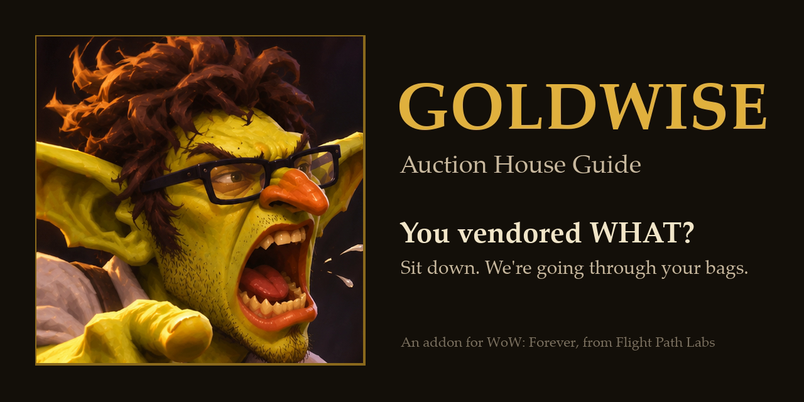
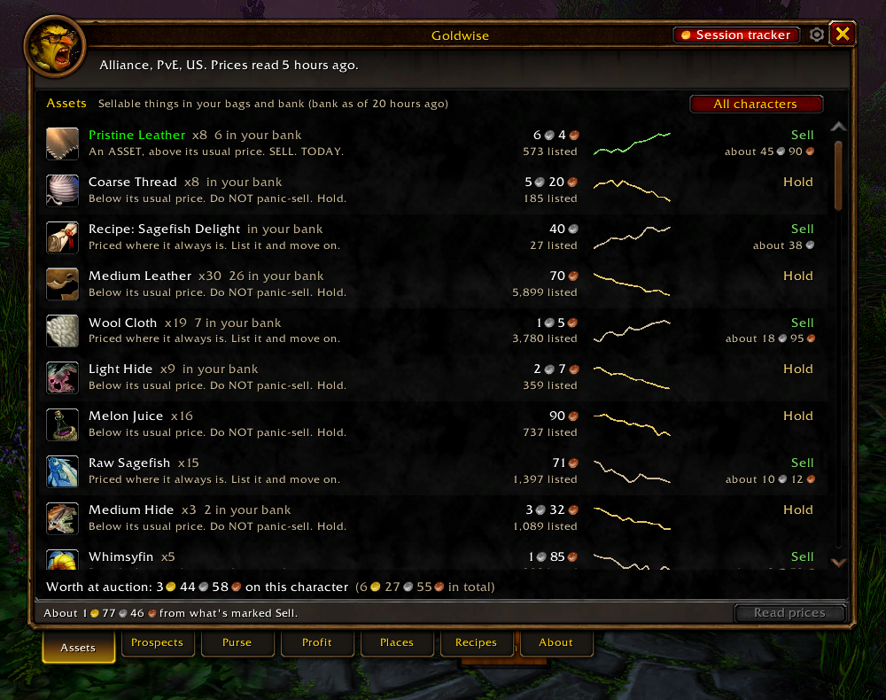
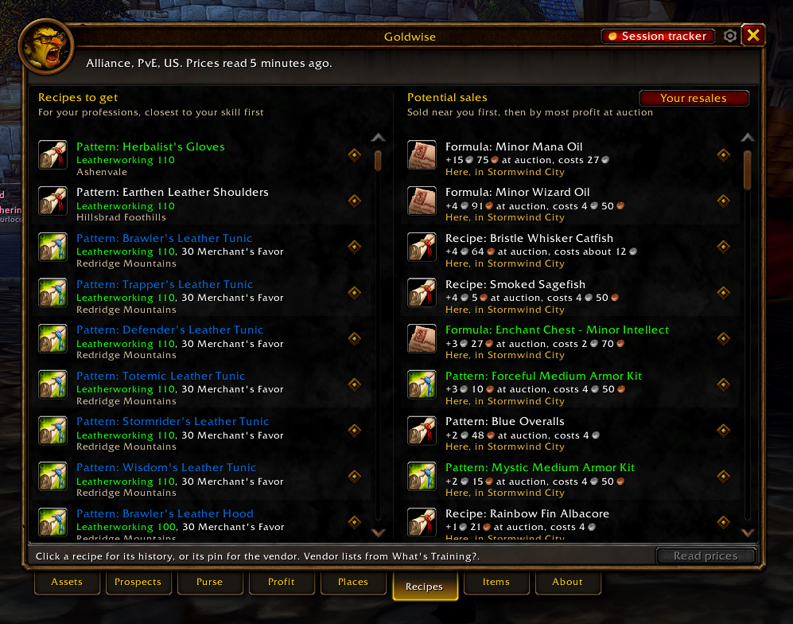
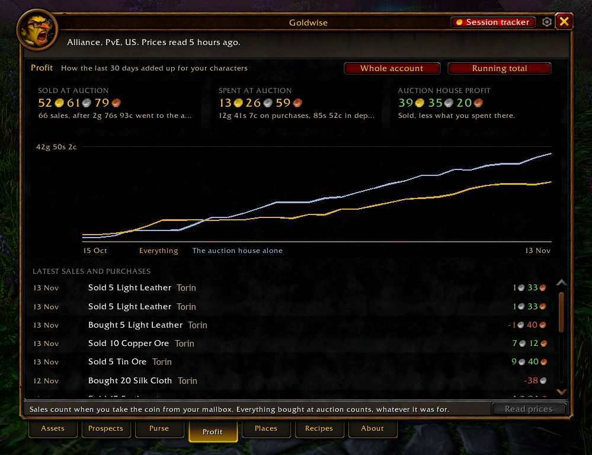
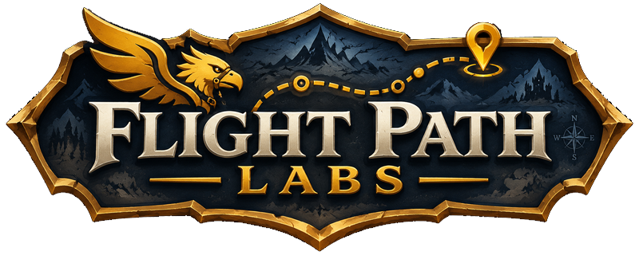

# Gold Wise



An auction house helper for World of Warcraft: Forever. It looks at what
you're carrying, checks recent auction prices, and suggests whether to
sell, hold, vendor or keep each thing.

It doesn't post, buy or cancel anything for you, and there's nothing to
set up.

[Download](https://github.com/flightpathlabs/GoldWise/releases/latest) ·
[What's new](CHANGELOG.md) ·
[Report a problem](https://github.com/flightpathlabs/GoldWise/issues/new/choose)

## What's in it

- **Assets:** what you hold, with a price, a trend and a suggestion.
- **Prospects:** pick a goal (gathering, crafting, reselling vendor
  recipes) and get a short plan.
- **Purse and Profit:** what you've earned and spent, and what's coming
  up, like training and repairs.
- **Recipes:** vendor recipes you haven't learned, and ones worth
  reselling.
- **Places:** the nearest trainer, bank, auction house and so on, with a
  map button.
- **Items:** any item's price history or crafting tree.
- **Session tracker:** a small panel showing what this play session has
  made.
- **Enemy values:** a creature's tooltip shows roughly what a kill is
  worth, learned from your own looting.







## Installing

Search for **Gold Wise** (with a space) in the CurseForge app, WowUp or
the Wago app. It's on
[CurseForge](https://www.curseforge.com/wow/addons/gold-wise) and
[Wago](https://addons.wago.io/addons/gold-wise).

To install by hand, download the `Goldwise-v...` zip from the newest
[release](https://github.com/flightpathlabs/GoldWise/releases) (not
"Source code") and unzip it into
`World of Warcraft\_forever_\Interface\AddOns\`.

## Getting started

Type `/gw` or click the minimap button, then visit an auction house once
so it can read prices. Opening your bank and profession windows once on
each character helps it know what you have.

| | |
|---|---|
| `/gw` | Open or close the window |
| `/gw history` | Price history for the item you last pointed at |
| `/gw tree` | Crafting tree for the item you last pointed at |
| `/gw goal 50` | Save toward 50 gold. `/gw goal off` clears it |
| `/gw session` | Show or hide the session tracker |
| `/gw report` | Gather what a bug report needs, ready to copy |

Right-click the minimap button for the options.

## Notes

- Prices come from your own auction house visits. Gold Wise players on
  the same market can share prices in game; you can turn that off.
- It works alongside Auctionator, Questie, Bagnon and others, and leaves
  out what they already show.
- Found a bug? Type `/gw report` in game and paste what it gives you into
  a [new issue](https://github.com/flightpathlabs/GoldWise/issues/new/choose).
  It includes no character names, realm or gold.

## For contributors

Work happens on `dev`; base pull requests there. `main` only moves at a
release. Changes go under "Unreleased" in [CHANGELOG.md](CHANGELOG.md).

```
Core/      startup, events, saved data, item names
Data/      tables: gathering, trainer prices, vendor recipes
Market/    which auction house, the request queue, scanners, price sharing
Ledger/    price storage and the sums over it
Profile/   what the player carries, banks, can make, and where things are
Advisor/   the rules that turn facts into advice
UI/        the window, tabs, charts, tooltips, cards and options
Media/     icon, portrait and artwork
```

Files load in the order in `Goldwise.toc`. Modules talk through the small
message bus in `Core/Events.lua`. On `dev`, `/gw demo` fills the screens
with invented figures for screenshots; release builds leave it out.
Formatting is StyLua and linting is luacheck.

## More from Flight Path Labs

Small addons for World of Warcraft: Forever, all at
[github.com/flightpathlabs](https://github.com/flightpathlabs).

- [Creel](https://github.com/flightpathlabs/Creel): a fishing log and one-key cast.
- [Temper](https://github.com/flightpathlabs/Temper): how your character fights, and whether a change helped. Coming soon.
- [Encore](https://github.com/flightpathlabs/Encore): helpers for enchanters. Coming soon.

## Licence

MIT. See [LICENSE](LICENSE).

Class training prices and vendor recipes in `Data/` come from What's
Training? by Sveng, also MIT; details in [THIRD-PARTY.md](THIRD-PARTY.md).
The goblin is an original cartoon; any resemblance to real people is
parody. Gold Wise is a fan-made addon, not affiliated with Blizzard
Entertainment.

<p align="center">
  <a href="https://github.com/flightpathlabs"></a>
</p>
