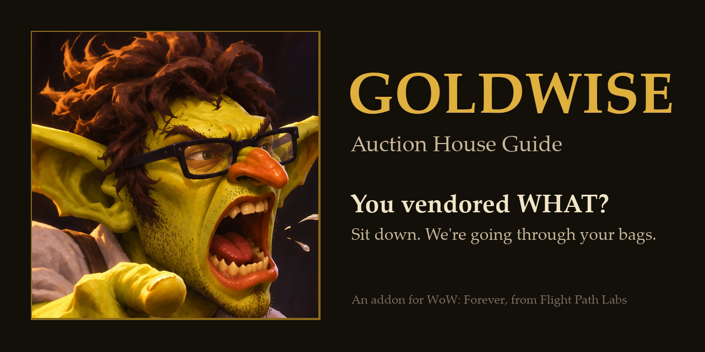
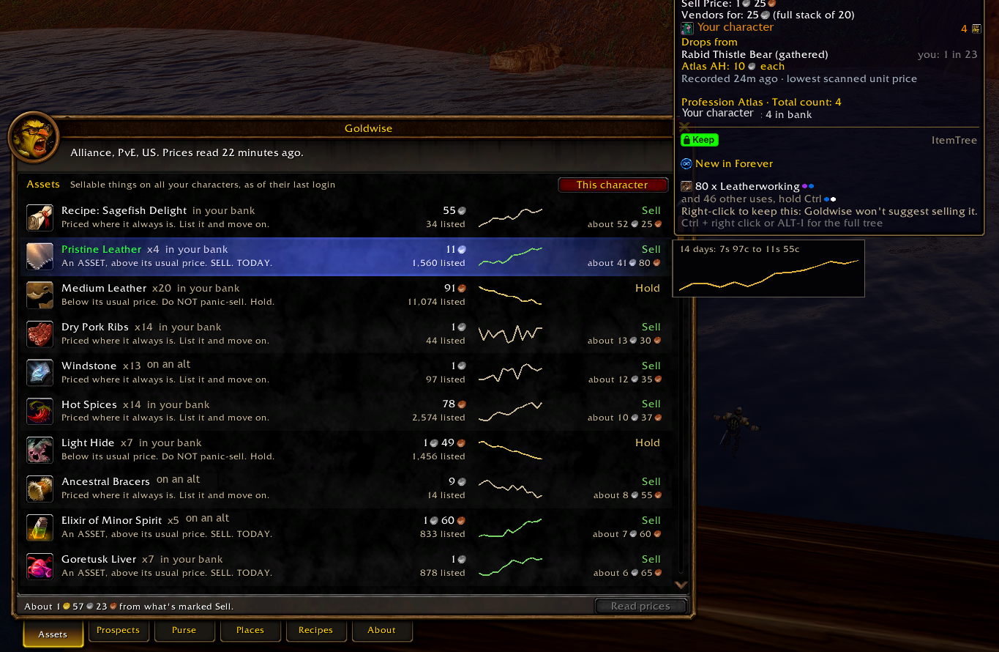
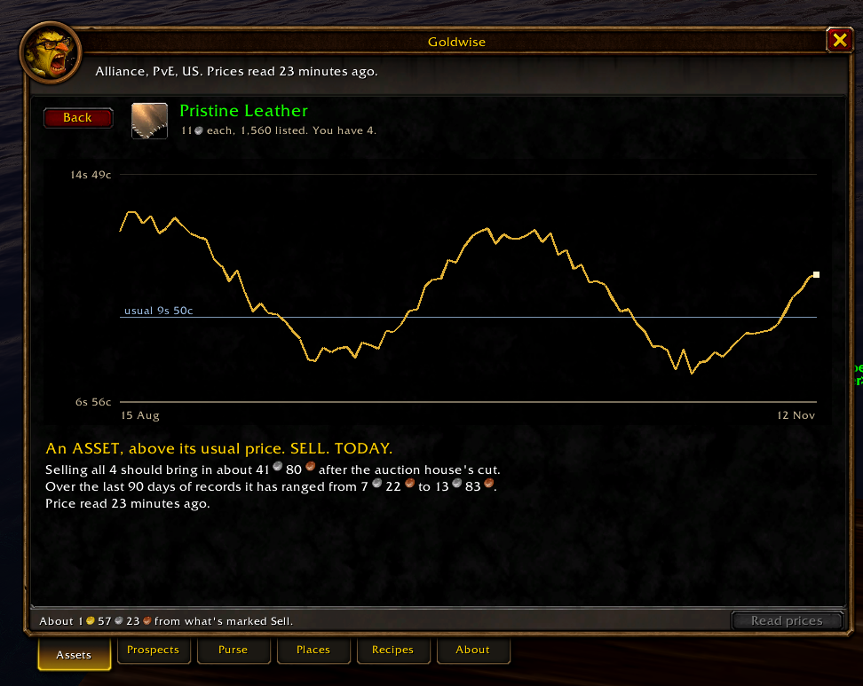
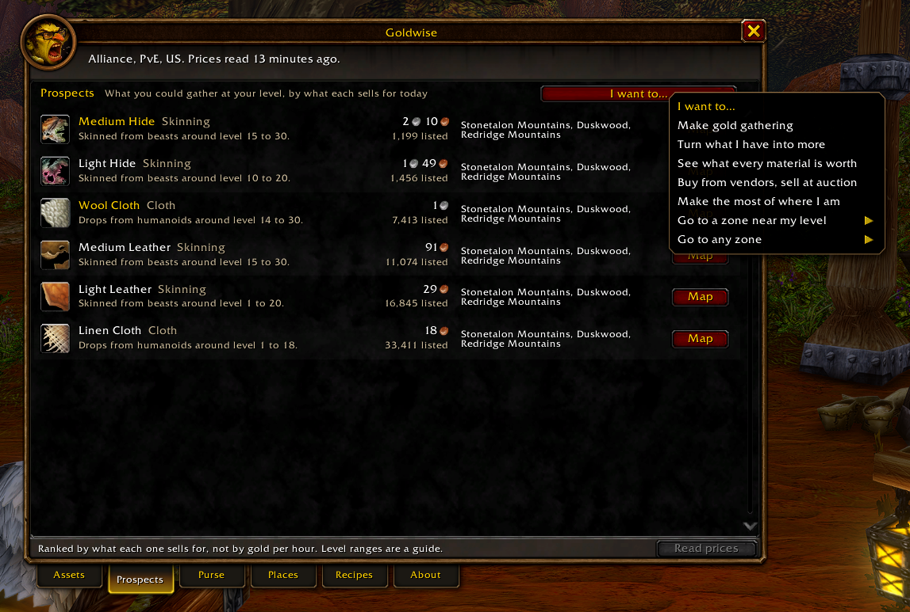
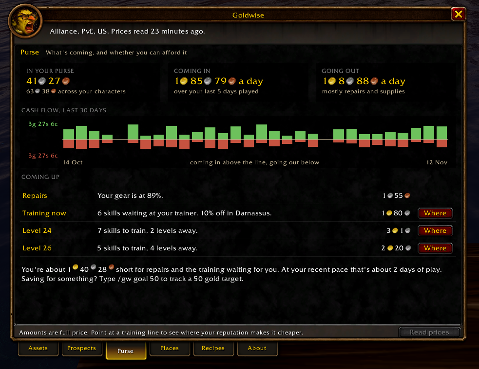
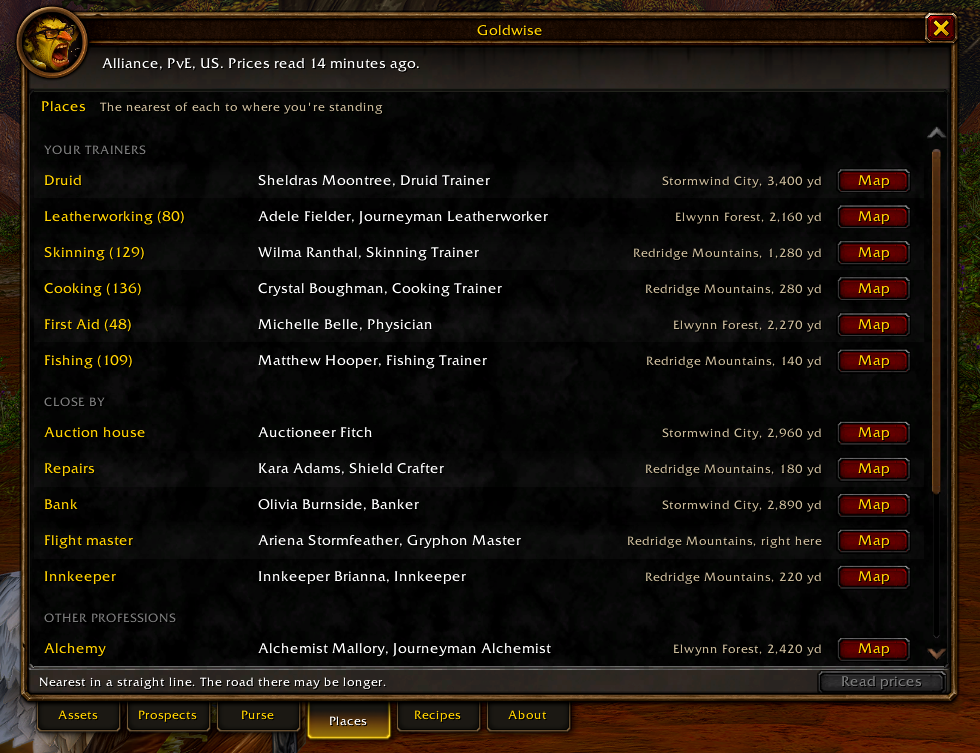
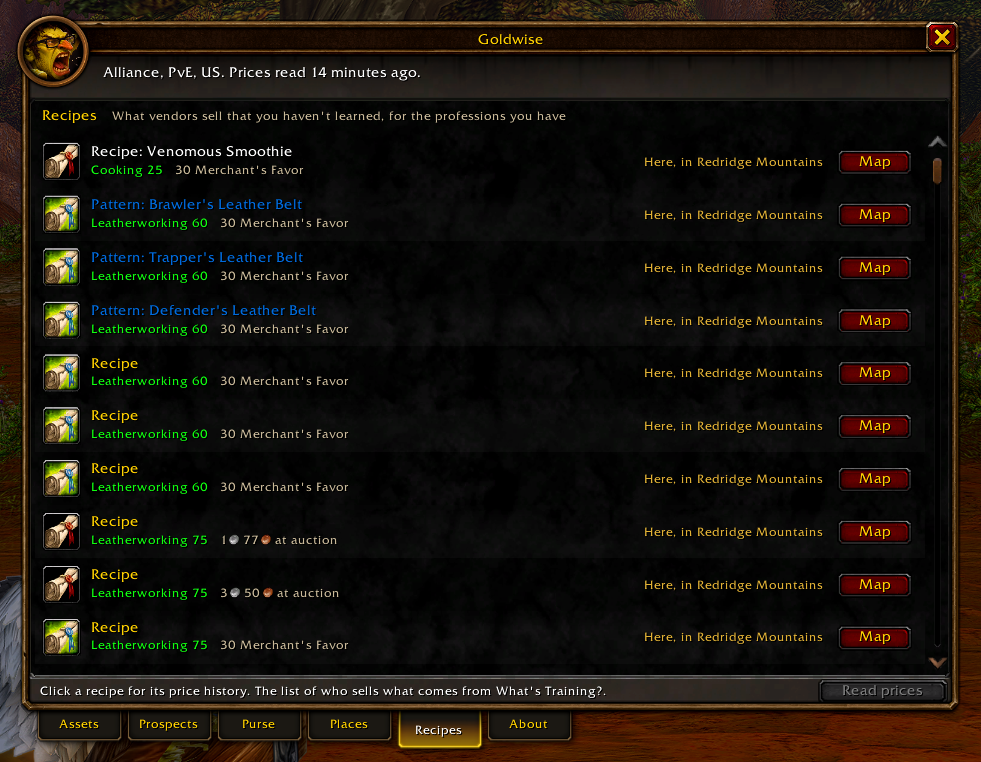
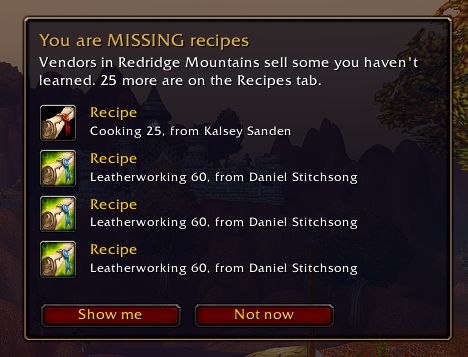
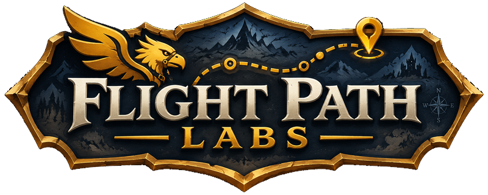

# Goldwise



An auction house guide for World of Warcraft: Forever. It works out what
the things you carry are worth, and tells you in a sentence what to do
with them.

Most auction addons are workbenches: powerful, and yours to figure out.
Goldwise is a guide. It needs no setting up. It learns from what your own
game sees, keeps quiet when it has nothing useful to say, and never posts,
buys or cancels anything for you.

**This is a beta.** It was built and tested on one faction of one ruleset,
on an English client. Expect rough edges, and please
[report them](#when-something-goes-wrong).

[Download](https://github.com/flightpathlabs/GoldWise/releases/latest) ·
[What's new](CHANGELOG.md) ·
[Report a problem](https://github.com/flightpathlabs/GoldWise/issues/new/choose)

## Installing

The easy way is an addon manager. Goldwise is on
[CurseForge](https://www.curseforge.com/wow/addons/gold-wise) and
[Wago Addons](https://addons.wago.io/addons/gold-wise), listed as
**Gold Wise**, with a space. The CurseForge app, WowUp and the Wago app
will all install it and keep it up to date: search for "Gold Wise" and
pick the one by FlightPathLabs.

To install it by hand:

1. Open [Releases](https://github.com/flightpathlabs/GoldWise/releases)
   and, from the newest one, download the file whose name starts with
   `Goldwise-v`. Not "Source code": that one unpacks under the wrong
   folder name and the game won't see it.
2. Unzip it into your game's addon folder:
   `World of Warcraft\_forever_\Interface\AddOns\`
   You should end up with `AddOns\Goldwise\Goldwise.toc`.
3. Start the game, or type `/reload` if it's already running. On the
   character screen, check that Goldwise is ticked under **AddOns**.

To update, do the same again and let it replace the old folder. Your price
history lives with your game settings, not in the addon folder, so it
stays.

If you use git, clone it into the addon folder under the right name and
update with `git pull`. The `main` branch is always the latest release:

```
git clone https://github.com/flightpathlabs/GoldWise.git Goldwise
```

Work in progress is on the `dev` branch. Add `-b dev` to try what's
coming next, knowing it has been tested less.

What changed in each version is in [CHANGELOG.md](CHANGELOG.md).

## Your first ten minutes

1. Type `/gw`, or left-click the Goldwise button on the minimap.
2. Visit an auction house and open it. Goldwise reads the prices (a panel
   on top of the window says how it's going) and steps aside if you start
   a search of your own.
3. Open your bank once, on each character. The game only lets an addon see
   a bank while it's open, so this is how what's in it gets counted.
4. Open each of your profession windows once. This is how Goldwise learns
   your recipes.

That's all the setting up there is, and none of it is required. Goldwise
gets sharper the more you play: prices from your first visit, charts and
"hold" advice once it has seen four different days, and the places you use
as you use them.

## A look around

### Assets: what's worth selling

Everything sellable in your bags and bank, on this character or all of
them, with the lowest price, a trend line and a verdict: **Sell**,
**Hold**, **Vendor** or **Keep**. Right-click anything you use to keep it,
and Goldwise stops suggesting you sell it. Fishing poles and profession
tools are kept from the start.

Point at any item, anywhere in the game, and a small price chart appears
under its tooltip. For something in your bags, the tooltip also carries
the verdict. Everything Goldwise adds to a tooltip is marked with its
name, so you can tell its lines from another addon's.



### Price history for anything

Click a row for the item's full history. For anything else you can point
at, type `/gw history`, give it a key under Options > Keybindings >
Goldwise, or type `/gw ` and shift-click the item.

The chart draws a point a day. A menu on the page switches it to every
separate reading over the last week or two days, for prices that swing
between morning and evening.



### A crafting tree for anything you can make

Alt-right-click an item you can make, or make something from, and
Goldwise lays out the whole chain: what it takes, what each of those
takes in turn, and what it goes into. Every step has its auction price,
what it costs to buy and what it costs to make, with the cheaper one
marked. The top of the page says what you'd clear by buying the
materials, making it and selling it. Click any row to walk up or down
the chain.

It follows the recipes your character knows, so open each profession
window once first. `/gw tree`, a key of your choosing, and the item's
price history page open it too.

The click and the keys are set under Options > AddOns > Goldwise >
Shortcuts. That page tells you when the click or key you've picked is
already used for something else.

### Prospects: tell it what you want to do

Press **I want to...** and choose:

- **Make gold gathering.** What you can gather at your level, by what it
  sells for.
- **Turn what I have into more.** Ore or bars? Cloth or bolts? What's
  worth making from what you hold, against selling the ingredients as
  they are, with the margin.
- **See what every material is worth.** Every trade good on the market,
  by kind, kept to what's within reach of your level unless you say
  otherwise. Pick one kind to see more of it.
- **Buy from vendors, sell at auction.** Recipes a vendor sells for less
  than they fetch at auction: what the vendor asks, what it's listed for,
  and the profit.
- **Go to a zone.** A numbered plan: what to see to before you leave, what
  to gather and buy while you're there, and who's on the spot.



### Purse: what's coming, and whether you can afford it

What you have, a chart of what's come in and gone out each day, and what's
about to cost you: repairs, training for the levels ahead, and anything
you're saving for (`/gw goal 50`). Training lines say where your
reputation makes it cheaper, and **Where** puts the trainer on your map.

A menu at the top sets how long a stretch each bar of the chart covers,
from a day down to an hour, or swaps the bars for a line of the coin your
characters hold between them. Days run midnight to midnight on your own
clock.



### Profit: are you coming out ahead?

A line for each of the last 30 days: everything that came in less
everything that went out, and the auction house on a line of its own.
Press **Running total** to see the same days added up as they went, or
**What you're worth** for your coin and goods together, day by day. Above
the chart is what you sold at auction, what you spent there on purchases
and deposits, and the difference. Below it are your latest sales and
purchases.

A sale is counted when you take the coin out of your mailbox. Everything
you buy at auction counts against the auction house's line, whatever you
bought it for.

Purse and Profit start on the character you're playing. The button
beside each tab's menu switches both to the whole account, where the
sales list says which character made each sale.

### Places: the nearest of everything

The nearest trainer for your class and each profession, and the nearest
auction house, repairer, bank, flight master and inn, each with a **Map**
button. Goldwise remembers the places you use. With
Questie installed it
knows the rest from the start.

For a craft, the trainer shown is the nearest one who can teach you more
at your skill, which isn't always the nearest one: a city can have three
tailors, each for a different stretch of the profession.



### Recipes: the ones you're walking past

What vendors sell that you haven't learned, for the professions you have,
and where to buy each.



### It speaks up when it matters

A few quiet cards, each once per visit and each with a switch in the
options: when you arrive somewhere with an auction house and a visit would
pay, when you open a merchant carrying things worth more at auction, and
when a vendor nearby sells a recipe you could use.

Or turn on **Auditor mode**, and the goblin delivers the same advice at
full volume.



Screenshots with long price histories use sample data (`/gw demo`). Yours
fill in as you play.

## How it decides

The rules are cautious on purpose. Bad advice costs trust quickly, so when
the gain is small or the data is thin, the answer is the safe one.

- If a stack is worth no more than the deposit it takes to list it,
  vendor it.
- If the auction house would pay no more than a vendor after its cut,
  vendor it.
- You get the deposit back when an auction sells and lose it when it
  doesn't, so Goldwise treats it as a stake. It assumes one listing in
  three comes back unsold: if the gain over a vendor isn't worth that
  risk, vendor it.
- Otherwise sell, unless the price is well below its usual level, in which
  case hold.

What a listing costs isn't fixed, and Blizzard has changed it before.
Goldwise asks the game each time you open the auction house and adjusts.

"Usual" needs at least four days of history. Until then the advice says so
rather than guessing.

## Commands

| | |
|---|---|
| `/gw` or `/goldwise` | Open or close the window |
| `/gw history` | Price history for the item you last pointed at |
| `/gw tree` | Crafting tree for the item you last pointed at |
| `/gw goal 50` | Save toward 50 gold. `/gw goal off` clears it |
| `/gw report` | Gather what a bug report needs, ready to copy |
| `/gw demo` | Fill the charts with sample history, for screenshots |

Right-click the minimap button for the options.

## Playing nicely with other addons

Goldwise checks what your other addons are already showing and doesn't say
it twice. If something else puts an auction price or a list of who holds
an item on your tooltips, Goldwise leaves those to it and adds only its
verdict and the chart. Turn the other addon's version off and Goldwise's
comes back. Where the other addon has no price for an item and Goldwise
does, Goldwise shows its own.

It also reads along when another addon scans the auction house first, so
nobody's scan is wasted, and the auction house isn't asked for the same
thing twice. When another addon has asked for every auction, Goldwise
waits for that answer and uses it.

None of these is needed, and there's nothing to switch on. Goldwise
notices what you have:

| With this installed | Goldwise |
|---|---|
| Auctionator | Reads the results of its scan instead of sending a search of its own, fills in prices Goldwise hasn't read yet from Auctionator's, and leaves the price on item tooltips to it |
| Profession Atlas | Waits for its read of every auction and uses that list, and leaves its tooltip lines and its progress panel alone |
| Questie | Knows where every trainer and recipe vendor stands from the start, not only the ones you've visited |
| Bagnon and other bag addons | Draws its gold rim in their bags and bank, and leaves the list of which characters hold an item to them |
| What's Training? | Asks it what your class training costs |
| TradeSkillMaster, Auctioneer | Leaves tooltip prices to them, and doesn't spend the full read of the auction house they share with it |

Auctionator, Profession Atlas, Questie and Bagnon are the ones Goldwise
is played beside every day. TradeSkillMaster and Auctioneer are
recognised but haven't had the same testing.

## Where its knowledge comes from

- **Prices:** your own game, at the auction house. Kept for 90 days, or
  30 days to a year if you choose.
- **Other players:** Goldwise players on your market pass each other
  fresh prices over a hidden chat channel. Only prices are exchanged, and
  you can turn it off.
- **Training prices and vendor recipes:** from
  [What's Training?](THIRD-PARTY.md) by Sveng, under its MIT licence.
- **Where things are:** the places you've used, and Questie's database
  when you have it installed. Nothing of Questie's is copied.
- **What can be gathered where:** written by hand from how these
  materials have worked since Classic, and not yet checked against
  Forever's own data. Treat it as a guide.

Everything is stored in one saved-variables file, `GoldwiseDB`, on your
own computer.

## When something goes wrong

Type `/gw report` in game. It gathers what's needed to track a fault down
(versions, your settings, any errors and a short log) into a box you can
copy. It includes no character names, realm or gold, and you can read it
before you send it.

Then [open a report](https://github.com/flightpathlabs/GoldWise/issues/new/choose)
and paste it in. Ideas are welcome at the same address.

## For contributors

Work happens on `dev`, and that's the branch to base a pull request on.
`main` only moves when a release is made, so it always matches what the
addon sites are handing out. Changes are noted under "Unreleased" in
[CHANGELOG.md](CHANGELOG.md) as they're made.

```
Core/      startup, events, saved data, item names
Data/      tables: what can be gathered and where, what trainers charge, what vendors sell
Market/    which auction house we're at, the request queue, the scanners, sharing between players
Ledger/    price storage and the sums done over it
Profile/   what the player carries, banks, knows how to make, and where things are
Advisor/   the rules and plans that turn facts into advice
UI/        the window, its tabs, charts, tooltips, cards and options
Media/     icon, portrait and artwork
```

Files load in the order listed in `Goldwise.toc`, and each group only uses
what the groups above it define. Modules talk to each other through the
small message bus in `Core/Events.lua`; the list of messages is at the
bottom of that file.

Formatting is StyLua and linting is luacheck, both configured at the
repository root.

## Disclaimer

Goldwise is a fan-made addon. Its goblin mascot is an original
cartoon character and the branding is a joke. Any resemblance to real
people, shows, apps or companies is parody, and Goldwise is not affiliated
with, endorsed by or sponsored by any of them. It offers advice about a
video game's auction house and nothing else: none of it is financial
advice.

World of Warcraft and related names and artwork are trademarks of Blizzard
Entertainment. This project is not affiliated with or endorsed by Blizzard
Entertainment.

## Licence

MIT. See [LICENSE](LICENSE).

The class training prices in `Data/Training/` and the vendor recipes in
`Data/Recipes/` come from What's Training? by Sveng, also MIT licensed. Its
licence and the details are in [THIRD-PARTY.md](THIRD-PARTY.md). Those
files are generated, and shouldn't be edited by hand.

<p align="center">
  <a href="https://github.com/flightpathlabs"></a>
</p>
